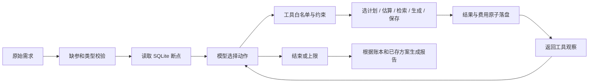

# 流程、模型决策与工程取舍

## 调用流程

核心代码：`agent.py` 负责有界循环和消息传递；`models.py` 负责真实 function calling 与离线策略；`tools.py` 检查业务依赖和约束；`store.py` 保存请求、尝试、故障计数与方案；`domain.py` 校验硬性输入并处理精确金额。

每轮是模型选择一个动作 → 工具执行 → 结果回给模型 → 模型决定下一步。模型可以因为预算、时间、部分素材或失败费用而换方案，也可以在持续故障时停止。程序不在工具失败后自动重试或自动调用低价方案。

## 六个工具

| 工具 | 模型参数（另含简短 reason） | 主要职责 |
|---|---|---|
| select_plan | premium/economy | 记录计划选择，保留既有结果；初始草案先评估再改选 |
| estimate_cost | 无 | 计算已花 + 剩余费用、预计完成时间、预算/时间缺口 |
| search_materials | primary/backup | 检索、记录成功/部分/失败；成功缓存后不重复收费 |
| generate_script | 无 | 验证素材依赖，生成合成模板；失败费与耗时也记账 |
| save_plan | 无 | 验证脚本成功、新鲜估算和硬约束；事务保存并读回 |
| finish | 无 | 结束；有可行工作却无依据提前结束时可拒绝 |

前四项业务能力（检索、生成、估算、保存）齐全，另两个是计划和结束控制。工具不接收预算、截止时间或价格参数。未知工具、额外字段、非法枚举会拒绝；没有发布工具。

## 费用与依赖

费用由整数最小单位存储，避免浮点累加误差。估算口径为：

`预计总费用 = 所有已执行尝试的实际费用 + 当前方案尚未完成步骤的费用`

premium 的初始费用为检索 2 + 脚本 10 = 12；economy 为 2 + 6 = 8。保存费用为 0，但耗时 1 分钟。生成失败消耗 1 单位、1 分钟，不能在重规划时抹掉。

若检索花 2 后 premium 生成失败花 1，已花为 3。继续 premium 需总计 13，换 economy 则总计 9。已有素材是共同依赖，不重新检索。部分检索花 1、只找到一项素材时，economy 可以复用并以总计 7 完成，原检索状态仍为 PARTIAL。

生成依赖当前策略所需的素材数量，保存依赖成功脚本和新的成本估算。执行前检查整个剩余方案是否可行，并对实际本次操作再次检查费用与时间。业务状态变化递增 version；估算记录 basis_version，保存时必须与当前状态匹配。选初始计划及其工具估算是执行骨架，之后如何调整仍由模型选择。

## 状态、幂等与恢复

`requests` 以请求 ID 为键，保存原始输入指纹、虚拟起点、所选策略、版本和估算。`attempts` 追加保存每次实际执行，含 step_key、SUCCEEDED/PARTIAL/FAILED、费用、分钟和结果。`plans` 每个请求仅一份方案。一次性故障的消费次数也持久化，重启不会重新触发同一故障。

失败后成功重试创建新尝试，旧 FAILED 不变。切换策略保留旧素材、失败步骤和全部费用。续跑将持久化快照作为新一轮模型输入，模型据此处理未完成部分。相同请求要求重复执行复用方案；同 ID 改要求则拒绝，避免把新预算混入旧账本。

SQLite 使用 BEGIN IMMEDIATE，将费用、结果和状态放入同一事务；成功步骤的缓存检查也在事务内，避免并发重复收费。保存后读回确认再报告成功。当前工具是本地合成函数，事务回滚能撤销本地账本操作；接入真实外部工具后，不能据此撤销服务商已发生的费用，需要外部幂等与对账机制。

## 运行边界与技术选择

Python 标准库与原生工具调用便于复制运行、检查循环和解释取舍。没有引入 Agent 框架或 SDK，无需框架版本。SQLite 满足单机持久化和并发唯一性；不把它描述成生产分布式 Runtime。公共 HTTP 适配器与验证脚手架在项目间复用，各目录包含独立副本，可以单独运行。

默认最多 24 次动作，硬上限 100；每个失败步骤最多两次实际失败。每次模型请求超时 45 秒、输出上限 600 token。API 失败不切换 Mock；额度错误通过共享停止信号阻止后续批量调用，模型由用户选择和更换。Trace 记录行动依据、参数、观察和后续动作，不索要内部思维过程。

`OfflineMock` 是手写分支策略，不算模型决策证据。真实路径使用模型返回的 function call。接口形式参考[OpenAI 官方 Function calling 文档](https://platform.openai.com/docs/guides/function-calling)；Qwen 非流式调用显式关闭思考模式。
