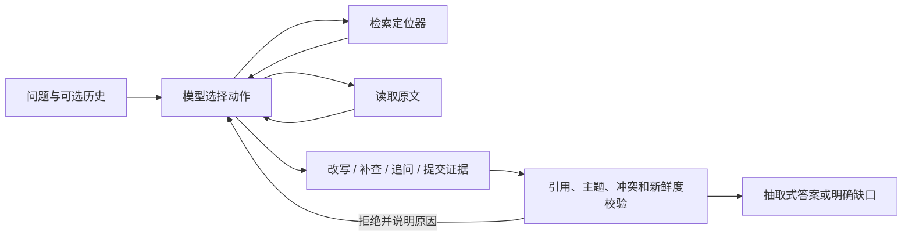

# 调用流程、检索与引用验证

## 模型与程序各自负责什么

`agent.py` 按模型返回的 function call 执行一次工具，把真实结果返回模型，再由模型决定下一步。`models.py` 使用真实 HTTP 工具调用；不是预先写好的决策日志。模型自行决定查询改写、读哪些片段、补查权威依据、提交冲突或追问。

工具程序只做执行和约束，不在失败后自动查询或重试。`submit_answer` 返回引用错误、未解决冲突或过期来源时，仍由模型选择下一工具。OfflineMock 是手写策略，明确标记为流程验证，不代表真实模型决策。

## 三个工具

| 工具 | 参数（另含简短 reason） | 返回或校验 |
|---|---|---|
| search_documents | query、literal/expanded | 只返回 ID/版本/片段等定位器、相关主题和排名，不提供可引用的全文 |
| read_fragment | doc_id、version_date、fragment_id | 限定检索已返回的定位器，读取完整原子片段与来源哈希 |
| submit_answer | 模式、fact_key、完整引用数组 | 验证原文、是否读取、主题、冲突覆盖及新鲜度，再渲染结果 |

没有任意 answer 文本参数。程序渲染的事实全部是已验证完整原句；模板只增加“依据原文”“存在冲突”和固定追问。这样避免模型改写数字或生成未获支持的附加结论，但不提供自由摘要式回答。

## 检索

`retrieval.py` 实现中文字符二元组 BM25，免去分词/向量依赖。expanded 模式使用 `topics.json` 的人工主题与同义表达，例如票据/报账到费用报销期限。对话中的用户前文可帮助解析指代，助手历史不参与主题权威判断，更不作为引用。

查询改写仍由模型发起；expanded 是可选工具模式。8 个预置查询对比给出实际 Hit@1、Recall@4，未声称独立留出评测。固定 top-4 与完整语料扫描适合本题五篇合成文档，不代表大库可扩展检索。

## 引用和冲突

`tools.py` 检查引用的完整原句与当前片段逐字相同，且该定位器已经读取。版本日期和内容哈希一起保留；日期相同而内容变化也会失效。最终返回前再次核对语料整体哈希，避免新增冲突文档后仍发布旧的无冲突结论。

主题约束来自人工配置的 anchors/relations 和用户前文，阻止用年假原文回答报销期限。它不是通用自然语言相关性或语义蕴含证明。只把 kind=policy/faq 作为政策事实，其他备注不可引用为制度；这不等于已解决资料真实性或来源投毒。

费用和年假期限按原文中的单一数字及单位比较，其他文本按保守的原子句比较。同主题不同说法需列出各自引用，并查适用范围/优先级。较新日期不会自动胜出；本原型不做自动权威裁决。文本差异的保守比较可能把实质一致的改写列为待澄清，这是已知限制。

闭集语料内会检查同主题所有当前片段，即使模型先只选了一个；若漏掉冲突，提交会被拒绝，并返回需要继续查证的定位信息。该机制只覆盖已装载的本地语料，不能证明不存在库外制度。

## 失败与运行限制

搜索/读取失败先由模型观察并重试，持续失败形成 TOOL_FAILURE，无事实引用。无资料须补查后再拒答；已知有相关文档时不能直接冒充“查无资料”。默认最多 14 次动作，最大 100；模型超时 45 秒、输出最多 600 token。达到上限返回 INCOMPLETE，不自动切换 Mock。

采用 Python 标准库与原生 function calling，无 Agent 框架或 SDK。HTTP 适配器、配额停止信号和部分验证脚手架复用公共适配器与验证脚手架，但本仓库运行独立。接口形式参考[OpenAI Function calling 文档](https://platform.openai.com/docs/guides/function-calling)；本次使用 qwen3.8-flash，非流式请求关闭思考模式。
