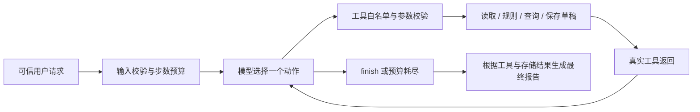

# 方案、动态决策与取舍

## 调用流程

`agent.py` 每轮请求模型选择一次动作，执行工具后将 observation 作为 tool 消息返回模型。`models.py` 的 `OpenAIModel` 通过真实 API 接收 function call；运行器没有按风险或冲突代替模型选择下一动作。模型可以先补查再审核、因冲突重查时间、因风险结束或在保存失败后停止。`finish` 是结束控制动作，另外四个是业务工具。

`OfflineMock` 是手写的结果分支策略，共用同一运行器和工具。它用于离线测试、异常注入和复现，不满足真实模型 ReAct 要求，也没有预先伪造执行日志。每份 Trace 都标注模式和模型。

## 工具与程序强制约束

| 工具 | 模型可提供的参数（另含简短 reason） | 程序负责的约束 |
|---|---|---|
| read_material | material_id、include_supplement | 限定本请求素材；从资料库取数据，不接受模型编造元数据 |
| check_rules | material_id | 必须已读取；执行版本化规则，返回缺失/风险及规则编号 |
| query_slots | material_id、include_alternatives | 按用户渠道、原始时间与候选窗口查冲突；排除本请求自己的旧草稿 |
| save_draft | material_id、slot | 审核通过、时间在窗口内、已查询；重新查冲突；由原请求决定确认状态；事务内防重复 |
| finish | 无业务参数 | 结束循环；没有权力指定最终成功状态 |

额外参数、错误类型、跨请求素材和未知工具均拒绝。因此即使模型声称“用户已同意”，也无法传入确认标志。提前 `finish` 且仍有未处理的正常素材时，工具返回 `FINISH_REJECTED`，将未完成素材交回模型继续选择动作；反复提前结束仍受步数上限约束。最终报告不使用模型生成的“已保存”等文字作为依据。

## 关键路径

- 正常：读取 → 审核通过 → 查询原时段可用 → 保存 → 结束。
- 缺资料：读取 → 审核返回缺字段 → 补查 → 重新审核 → 仍缺则请求补充；若补齐则继续排期。
- 风险：审核返回阻断或人工审核 → 结束该项，不保存。
- 冲突：原时段不可用 → 查询替代时段 → 保存待确认建议。原定时间不变。
- 保存时出现新冲突：工具拒绝写入 → 模型重新查询并选择；并非无条件重试。
- 保存失败：返回失败 → 模型结束该项；结果保持 SAVE_FAILED。

这些路径已用 Mock 和真实 `qwen3.8-27b` 分别验证，均为 13/13 组通过。真实 Trace 中正常、冲突、补查、阻断和故障路径选择了不同的后续工具。

## 幂等与并发

SQLite 主键为 `(request_id, material_id)`。原始要求（素材、时间、硬性要求、渠道）的规范化 JSON 生成 SHA-256 指纹；同键不同要求拒绝。用户 approval 不属于需求指纹，允许在同一记录中确认先前建议。

保存使用 `BEGIN IMMEDIATE`，把当前 SQLite 草稿的冲突检查和写入串行化，写后在同一事务中读回校验，提交失败也不会返回成功。四个并发相同请求只留一行；不同请求抢同一时段只有一个成功。已有有效草稿优先复用；旧时间新增占用后可以更新同一记录的建议时间与 revision，旧时间的确认不能批准新时间。

已有排期 JSON 在查询和保存时分别读取，报告时再次核对。JSON 与 SQLite 之间没有跨系统事务，不能代表生产排期服务的全局一致性；真实接入应使用排期服务的版本或原子预留接口。待确认草稿暂占候选时段，当前没有过期回收策略。

## 技术选择

- Python 3.11+ 标准库：便于复制运行，不引入框架版本与安装成本；框架职责（工具协议、循环、预算、Trace）在少量代码中显式实现。
- SQLite：适合单机草稿、事务和唯一键，避免 JSON 文件并发覆盖。
- 原生 function calling：模型直接选择工具与参数。没有依赖模型文本中的伪动作或固定的预设决策日志。
- 真实/Mock 分离：配置错误和调用失败不自动切换模式，评估证据可区分来源。
- 额度策略：本次按用户要求固定模型、额度不足报告后由用户换模型。另提供控制台保护声明后的候选列表切换；只认明确免费额度耗尽代码，不会关闭保护或把 429 限流当作额度耗尽。该切换机制仅离线模拟验证，未声称实际耗尽/切换成功。
- 有限预算：默认 12 次动作，硬上限 100；每次请求最多输出 600 token、超时 45 秒，日志只保留行动依据与工具结果，不索要内部思维链。

工具协议参考：[OpenAI 官方 Function calling 文档](https://platform.openai.com/docs/guides/function-calling)，本次已实际读取该页面。没有使用 Agent 框架或 OpenAI SDK，无需注明框架版本。CLI 模式中用户输入视为已认证；真实产品必须在入口绑定身份及确认记录。
