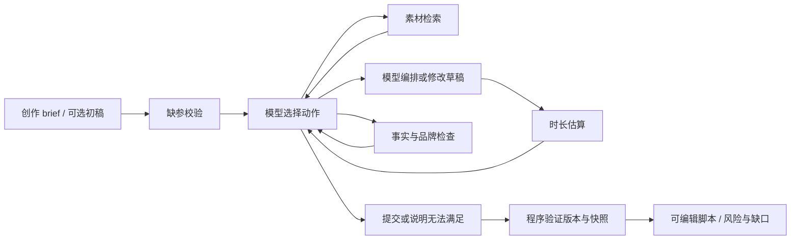

# 模型循环、事实与版本检查

## 工具与动态决策

`agent.py` 每步请求真实模型返回一个 function call，执行后将 observation 交回模型。模型选择查询改写、表达 ID、视觉顺序、素材事实、停留时间和修订；工具不自动压缩或改风格。服务端拒绝不合格提交时，下一步仍由模型选择。

| 工具 | 输入（另含简短 reason） | 职责 |
|---|---|---|
| search_materials | query、literal/expanded | 返回可引用的完整已批准事实、版本和哈希 |
| write_draft | title_id、结构化分镜 | 生成 UNVERIFIED_DRAFT，不能跳过检查 |
| estimate_duration | draft_id | 根据实际旁白与停留时间逐镜估算、求和和比较上限 |
| check_rules | draft_id | 核对事实、主题、风格、结构、必需事实与禁用表达 |
| submit_script | draft_id | 只批准当前版本、当前数据下的双检查通过结果 |
| stop | 缺素材/工具失败/约束失败 | 根据实际检查和失败记录形成明确缺口 |

用户提供 D0 时，必须先估算和检查该初稿，再修改；这是一段允许预设的执行骨架。看到超时或品牌问题后如何改、用哪些分镜和停留时间由模型决定。已有当前合格版本时，不再接受无必要的自动重写；后续人工编辑可启动新的检查请求。

## 事实契约与可编辑性

事实分镜使用 FACT，其 source_id/fact_id/source_quote 必须等于实际检索返回的完整原句，且当前来源内容未变化。其他表达只能引用给定库 ID，标题和视觉也受限。这样既不把产品事实交给自由改写，也能让模型调整画面/叙事编排。事实与中性创作表达分开，不声称表达库就是经过真实品牌审批的资料。

最终 JSON 保留结构化 spec 对应的 ID、渲染文本、时长和引用，Markdown 提供可读可编辑表格。人工库外改写会被 validate_script.py 标为需重新审阅；修改后验证器不信任旧的 APPROVED 字样或旧秒数。

## 时长与修正

时长由每镜最大值求和，停留时间缩到零也不能绕过旁白和最小镜头时间。默认每秒四个单位、每镜两秒；连续英文/数字词为两单位。上限由原始输入提供，模型没有覆盖参数。这里没有 TTS/视频实测，目标只解释为上限，未支持目标区间和实际语速校准。

离线策略在例子中选择 28 秒；真实完整验收选择了 19 秒。二者都保留 P01，且有各自的工具估算。实际值来自运行，不用固定的“修正为 28”日志代替结果。

## 版本与快照

每次 write_draft 产生新 ID 和内容哈希。估算、规则检查分别记录 draft_id、draft_hash、data_hash。修改后不能复用前一版本的通过记录；检索事实、规则或表达库变化会使检查失效。检查结果绑定实际读取的同一份快照，而非检查结束时重新读取的新快照，避免把旧规则的通过结果贴到新规则上。

提交时校验双检查、时长、风险与当前快照，最终交付前再确认来源未变。草稿保留 UNVERIFIED_DRAFT 的创建状态，批准后的独立 script 才是交付物。失败场景的公开导出写成未通过说明，避免残留旧成品。

## 取舍与限制

Python 标准库、原生工具调用和本地 JSON 便于复现，无 Agent 框架、向量服务或 TTS 依赖。HTTP 适配器、配额停止信号和部分验证脚手架复用公共适配器与验证脚手架，仓库运行独立。用户指定 qwen3.8-flash，关闭思考模式，单次输出上限 1,400 token 以容纳结构化分镜。

默认最多 18 次动作、4 份草稿，每次模型超时 45 秒。API 失败不切换 Mock，额度不足由用户更换模型。OfflineMock 是固定测试策略，不证明模型决策；真实记录包含不同分镜编排与修订路径。接口形式参考[OpenAI Function calling 文档](https://platform.openai.com/docs/guides/function-calling)。
